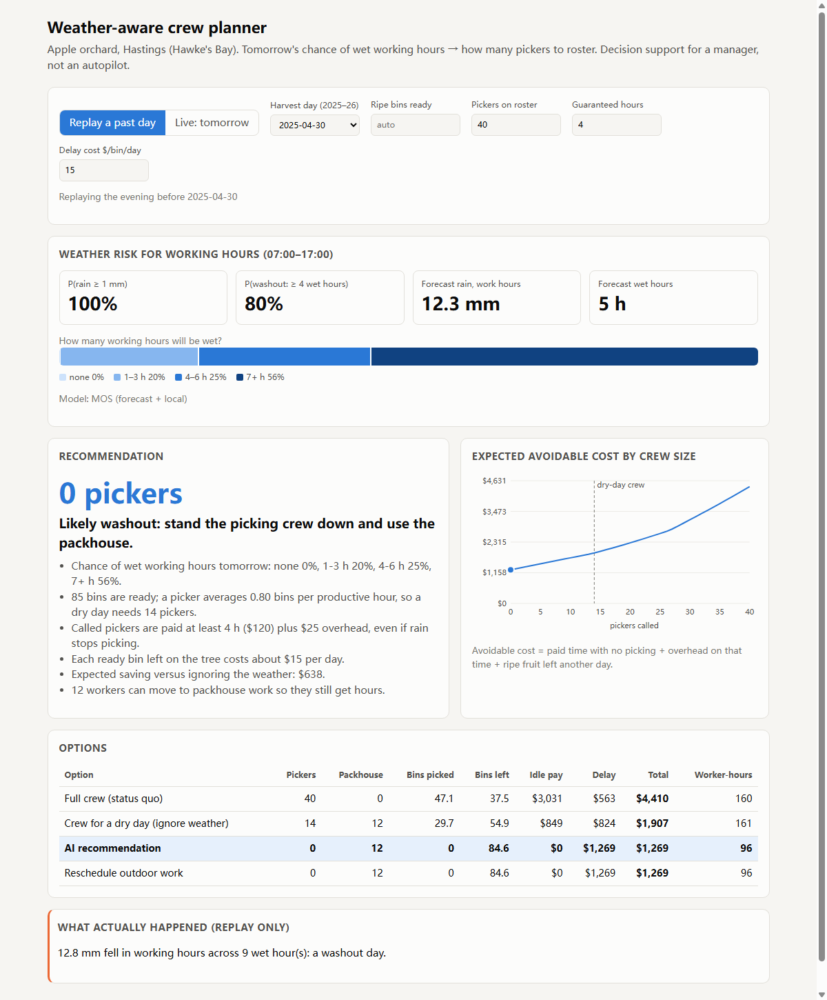
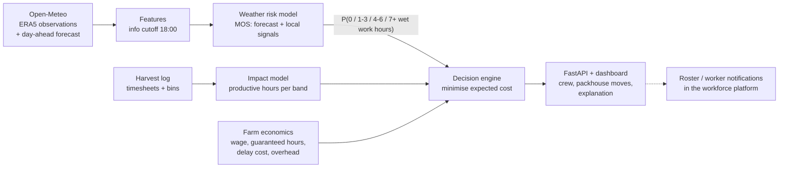
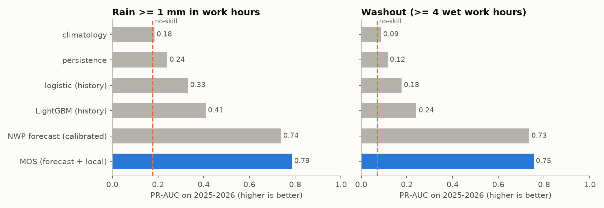
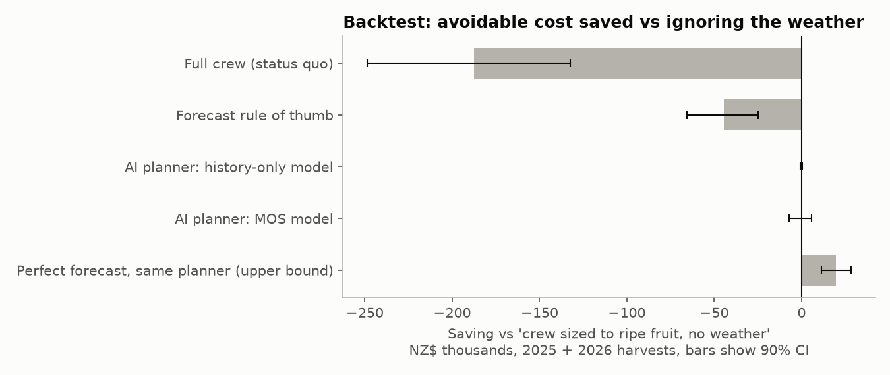
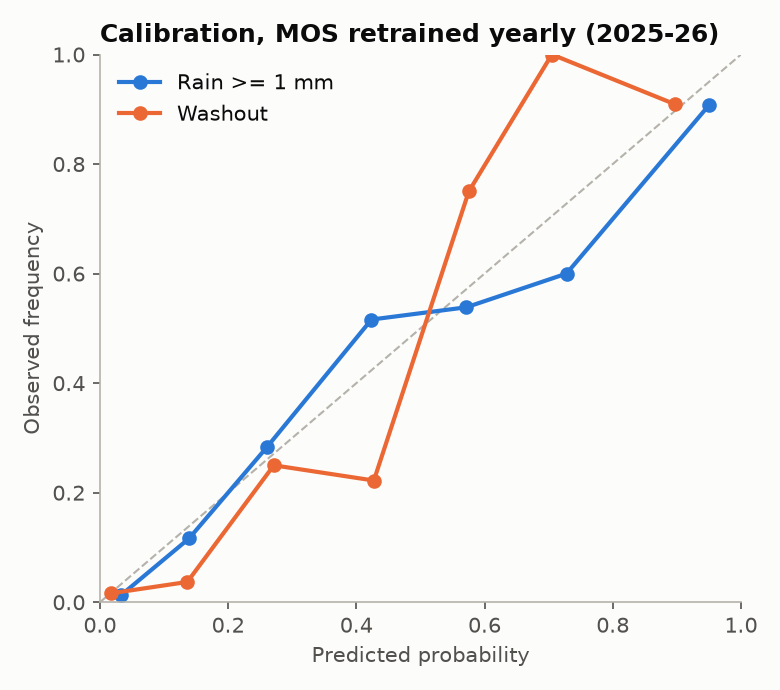

# Weather-Aware Workforce Planning

**Decision support that turns tomorrow's weather risk into a picking-crew recommendation for an orchard.**

> The goal is not to predict the weather. It is to turn weather predictions into better workforce decisions, and to measure whether they really are better.

Built as an end-to-end prototype for an AI decision-support layer on top of a workforce platform (rosters, timesheets, harvest tracking). It uses real NZ weather data, a simulated orchard and a FastAPI service with a dashboard.



---

## The problem

At 6pm a manager rosters tomorrow's pickers. If it rains, called-in workers are paid their guaranteed hours while no fruit is picked. If the manager under-rosters on a fine day, ripe fruit hangs another day and loses value. The question is how many pickers to call.

## What the system does



1. **Weather risk.** It predicts how many of tomorrow's working hours (07:00–17:00) will be wet, as a probability for each band: 0, 1–3, 4–6 or 7+ hours. It also reports P(rain ≥ 1 mm) and the expected rainfall in mm.
2. **Impact.** It learns from the harvest log how many productive hours crews actually got on days in each band.
3. **Decision.** For every crew size from 0 to 40 it computes the *expected* avoidable cost and recommends the cheapest. Workers who aren't picking are offered packhouse work so they keep their hours.
4. **Explanation.** The dashboard shows the recommendation, the reasons, the cost curve and the alternatives side by side. The manager decides.

## Data

| Source | What | Period |
|---|---|---|
| Open-Meteo archive (ERA5) | Hourly temperature, humidity, rain, pressure, cloud, wind, gusts at Hastings, Hawke's Bay | 2010-01 → 2026-09 |
| Open-Meteo previous-runs API | **Day-ahead** forecast as issued the day before (`*_previous_day1`) | 2024-01-20 → 2026-09 |
| Simulated harvest log | One row per picking day: crew called, productive hours, picker-hours paid, bins picked. Driven by the real hourly weather | 2010–2023 seasons |

No public picking dataset exists, so the harvest log is **simulated**, and its rules are explicit in [`workforce.py`](src/wwp/workforce.py):
- an hour with ≥ 0.3 mm of rain stops picking, and so does the hour after it (drying);
- gusts ≥ 65 km/h stop ladder work;
- above 30 °C pickers slow to 70%.

With real timesheet and harvest-tracking exports, `generate_harvest_log` is replaced by a loader and nothing downstream changes.

## Results

All results come from a strict time split. History models train on 2010–2023, forecast models are retrained each year on earlier years only, and the test period is **2025-01 → 2026-09** (638 days).

### 1. Weather models: the professional forecast plus local correction wins

| Model | Rain ≥ 1 mm: PR-AUC | Brier | Washout (≥ 4 wet h): PR-AUC | Brier |
|---|---|---|---|---|
| Climatology | 0.18 | 0.146 | 0.09 | 0.065 |
| Persistence | 0.24 | 0.140 | 0.12 | 0.062 |
| Logistic regression (today's observations) | 0.33 | 0.134 | 0.18 | 0.062 |
| LightGBM (today's observations) | 0.41 | 0.129 | 0.24 | 0.059 |
| NWP day-ahead forecast, calibrated | 0.74 | 0.078 | 0.73 | 0.031 |
| **MOS: forecast + local signals** | **0.79** | **0.072** | **0.75** | **0.031** |

Base rates are 17.7% rain days and 6.9% washout days.



**Lesson:** a model trained only on past station data can't compete with a numerical weather model. The right ML job is to *post-process* the professional forecast for this site and for the target that matters (model output statistics, MOS). Tree models only beat logistic regression on the history-only problem.

### 2. Decisions: honest backtest on two unseen harvests (2025 and 2026)

Every policy faces the same real weather and the same random draws. Unpicked fruit carries over to the next day.

| Policy | Avoidable cost | vs. no-weather baseline (90% CI) | Paid hours on washout days |
|---|---|---|---|
| Full crew every day (status quo) | $311.7k | −$187.7k | 640 |
| **Crew sized to ripe fruit, no weather (baseline)** | **$124.0k** | 0 | 352 |
| Forecast rule of thumb (halve crew if ≥ 1 mm forecast) | $168.6k | −$44.6k [−65.6k, −24.8k] | 80 |
| AI planner, history-only model | $124.2k | −$0.2k [−0.8k, +0.4k] | 348 |
| AI planner, MOS model | $124.4k | −$0.4k [−7.1k, +5.8k] | 244 |
| Perfect forecast, same planner (ceiling) | $104.3k | +$19.6k [+11.4k, +28.3k] | 0 |



What this shows:
- **The biggest win is plain planning.** Sizing the crew to the ripe fruit saves $188k compared with calling everyone every day.
- **Using a forecast naively is worse than ignoring it.** Halving the crew whenever any rain is forecast costs $45k more.
- **Perfect weather knowledge would be worth about $20k** over two seasons at these costs. That is the ceiling for any weather model.
- **At default costs the MOS planner breaks even.** It cuts paid washout hours by 31% (352 → 244). Across the decisive days it made 2 correct stand-downs (+$4.2k), 2 false alarms (−$3.8k) and missed 3 washouts where the rain wasn't forecast confidently enough. Two harvests give too few rain days to separate it from zero.

### 3. When does weather AI pay? It depends on the farm's economics

MOS planner saving vs no-weather baseline (90% CI) over the 2025 + 2026 harvests:

| Delay cost per ripe bin per day | Guaranteed 2 h | Guaranteed 4 h | Ceiling (perfect forecast, 4 h) |
|---|---|---|---|
| $5 | −$2.8k [−9.2, +3.7] | −$2.7k [−12.4, +7.4] | $16.8k |
| $10 | +$0.5k [−4.9, +5.3] | −$7.7k [−19.8, +4.2] | $18.2k |
| $15 (default) | +$1.0k [−4.5, +5.7] | −$0.4k [−7.1, +5.8] | $19.6k |
| $25 | **+$9.3k [+4.3, +14.7]** | +$5.5k [−2.0, +12.8] | $30.0k |
| $40 | **+$16.7k [+7.6, +26.6]** | **+$16.6k [+8.3, +25.4]** | $41.3k |

**Takeaway:** a forecast is only worth acting on when wrong calls are expensive. That happens for fruit with a short picking window or a high value, where a day's delay costs $25 or more per bin. A workforce platform already holds the numbers needed to compute this per customer (pay rules, crew sizes, harvest volumes), so this table could become a "should this farm use it?" check.

## Design log: what changed and why

The decision backtest drove most of the design, so I'm listing the iterations openly. Because these changes were made after looking at 2025–26 results, the 2027 harvest is the truly clean test.

1. **v1 objective counted all wages as cost** → the planner rostered nobody, because leaving fruit always looked cheaper. Fixed: picking labour is spent eventually, so only *idle* paid time and fruit delay are avoidable.
2. **Too little capacity headroom** (230 bins/day ripening at peak against 256 bins/day crew capacity) → one bad day snowballed into multi-day backlog. Set ripening to 180 bins/day at peak (about 70% of full-crew capacity), typical headroom.
3. **Target was "≥ 5 mm of rain"** → the planner cancelled crews for a single 11.5 mm burst forecast at 4 pm. Crews lose *hours*, not millimetres, so the target became **wet working hours**.
4. **Only one washout class** → it mixed 0-hour and 5-hour days. Replaced by four bands, with productive hours of 8.0, 7.1, 3.9 and 0.6 respectively.
5. **No per-worker overhead** → the planner over-called on dry days and cut each worker's hours. Added overhead (transport, supervision), counted only on unproductive time.
6. **Single training year for MOS** → it now retrains each year on all earlier forecasts, as production would.

## Responsible AI notes

- **Worker hours are a second outcome.** Seasonal workers (e.g. RSE) depend on hours. The planner offers packhouse work before cancelling, and the backtest reports hours per worker per week (about 40 under the AI planner, the same as the baseline).
- **The manager decides.** The output is a recommendation with reasons and alternatives, not an automatic roster change.
- **Calibration over accuracy.** Decisions use probabilities directly, so the system is evaluated with Brier score and reliability plots, not accuracy (an "always dry" model is 82% accurate and useless).



## Limitations

- ERA5 reanalysis (about 25 km grid) stands in for an on-orchard weather station. Real station data would sharpen both training and evaluation.
- The harvest log and farm economics are simulated or assumed (see [`config.py`](src/wwp/config.py)).
- The planner is myopic (one day ahead). It doesn't plan around Sundays or a coming wet week.
- Only about 2.7 years of archived day-ahead forecasts exist for this site, so MOS trains on a small sample.
- Training/serving skew: live "recent history" comes from the forecast model's analysis, not ERA5.

## Next steps

1. **A two-stage decision: evening plan, then a 6 am go/no-go.** Workers are notified through the app before they travel. This would catch the missed all-day-rain washouts, and it's probably the biggest lever.
2. **Multi-day planning (rolling horizon):** e.g. "rain Thursday → bring Friday's work forward to Wednesday".
3. **Real data:** timesheets and bin counts instead of the simulator, and productive hours learned per crop, block and crew.
4. **Monitoring:** rolling Brier score and drift checks on forecast features, and retraining before each season.

## Run it

```bash
python -m venv .venv && .venv/Scripts/activate        # Windows; use .venv/bin/activate on macOS/Linux
pip install -r requirements.txt
set PYTHONPATH=src                                     # export PYTHONPATH=src on macOS/Linux
python -m wwp.pipeline        # downloads weather (~1 min), trains, backtests, writes reports/
pytest -q                     # 8 tests
uvicorn app.main:app --reload # http://localhost:8000
```

API: `GET /api/plan?date=2025-04-30` (replay a past day), `GET /api/plan/live` (tomorrow, from the live forecast), `POST /api/recommend` (what-if), docs at `/docs`.

## Project layout

```
src/wwp/
  config.py          site, time split, farm economics (all assumptions in one place)
  data_weather.py    Open-Meteo download + cache
  features.py        target-day features with an 18:00 information cutoff; targets
  weather_models.py  model ladder, MOS, yearly walk-forward retraining
  workforce.py       harvest simulator, cost of a crew decision, impact model
  decision.py        expected-cost crew optimiser + explanations
  backtest.py        policy replay, block bootstrap CIs, cost sensitivity grid
  pipeline.py        end-to-end run + charts
app/main.py          FastAPI service;  app/static/index.html  dashboard
tests/test_core.py   leakage, targets, cost logic, monotonicity, API smoke test
```
